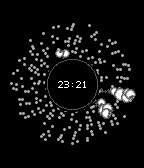

# Prime Spiral

A native Pebble watchface. Prime numbers form a sunflower of light, and three
invisible bearings sweep through it to mark the hour, minute and second.



The field holds every integer from 2 through 1800, including all 278 primes,
each placed by the golden angle. As a bearing passes, nearby primes brighten
and grow. The hour bearing reaches 58% of the field radius, the minute 80%,
and the second the outer edge.

The face updates once a second. Tap your wrist for about six seconds of
smoother motion at eight frames a second; leaving the face stops it early.
There are no settings, and the face needs no phone connection, account or
network access.

## Watches

| Platform | Watch | Display |
| --- | --- | --- |
| basalt | Pebble Time, Time Steel | 144 × 168, color |
| chalk | Pebble Time Round | 180 × 180, color, round |
| diorite | Pebble 2 | 144 × 168, monochrome |
| emery | Pebble Time 2 | 200 × 228, color |
| flint | Pebble 2 Duo | 144 × 168, monochrome |
| gabbro | Pebble Round 2 | 260 × 260, color, round |

## Install

Prime Spiral is not on the Pebble Appstore. Install
[release/prime-spiral-1.0.1.pbw](release/prime-spiral-1.0.1.pbw) with the
Pebble phone app or `pebble install`, or build it from source. `release/`
also has the source ZIP and SHA-256 checksums for each version.

## Build and test

Use Pebble SDK 4.33.1 and a host C compiler (Clang by default). Normal builds
use the checked-in resources. Python 3 regenerates the source tables
(`make assets`), and Pillow redraws the menu icon. The face has no external
font or library dependencies.

```sh
make test
pebble build --sdk 4.33.1
```

Pebble names the output after the project directory: in a directory named
`prime-spiral`, it is `build/prime-spiral.pbw`. The source ZIP holds the
project at its root and builds on its own.

The emulator scripts need the Python environment that has `pebble-tool`. Run
each platform before packaging:

```sh
python test/emulator.py basalt --fresh
python test/emulator.py chalk --fresh
python test/emulator.py diorite --fresh
python test/emulator.py emery --fresh
python test/emulator.py flint --fresh
python test/emulator.py gabbro --fresh
python test/package.py
python test/independent.py --pebble pebble
```

Each capture uses a fresh emulator profile. The checks cover installation,
logs, changing seconds, natural noon and midnight rollovers, a wrist tap, and
the return to one update per second. Packaging verifies each platform's
application and resource CRC, the metadata and the evidence hash.
[evidence/README.md](evidence/README.md) describes the results. Build logs in
earlier commits contain absolute paths from the original build machine.

## How the port works

I made the original [Prime Spiral](https://datapoems.io/clocks/prime-spiral/)
as a web clock. Its HTML and a screenshot are in `reference/`, and
[provenance.json](reference/provenance.json) records their hashes.

The port keeps the source's sieve, golden-angle coordinates, local time, three
radial limits and Gaussian brightness response. Integer tables avoid runtime
trigonometry. Host tests compare the generated points with the source formula
and keep brightness error below 0.008 on a 0 to 1 scale.

The field stays circular on both screen shapes, with a radius of 43.5% of the
shorter screen dimension. The web version shows a digital readout in the
center; the watchface leaves it out and shows only the prime field and its
three bearings.

Color screens use white and gray discs in place of blur and opacity.
Monochrome screens keep white prime dots, use size for emphasis, and show only
a sparse subset of the faint composite points. The browser's continuous motion
becomes one update per second, plus the tap animation.

The package UUID is `3b314f24-6f15-4790-b841-d1767a0c8663`. Keep it unchanged
for updates.

## License

Copyright 2026 Luke Steuber. [MIT License](LICENSE). No third-party fonts,
images or code are bundled.
